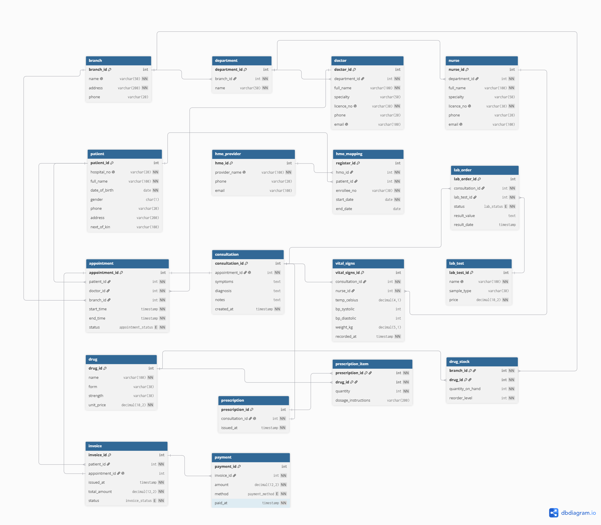

# Portfolio 1 — Database Design and Modelling

**Case study:** CarePoint Specialist Clinic, a simulated outpatient clinic with 3 branches in Lagos.
**DBMS:** PostgreSQL 18 · **Schema:** `clinic` · **Tables:** 18 · **Views:** 1

## 1. Files in this folder

| File | Purpose |
|---|---|
| `entities.md` | Entities, attributes, relationships, cardinality and design decisions |
| `erd.png` / `erd.dbml` | ER diagram (image) and its source code (dbdiagram.io) |
| `schema.sql` | Creates all tables, keys, constraints, the partial unique index and the view |
| `sample-data.sql` | Valid sample data (re-runnable; resets IDs) |
| `test-constraints.sql` | 16 negative and 3 positive constraint tests |
| `test-results.txt` | Saved output of the test run |
| `screenshots/` | Evidence from pgAdmin and the test run |

## 2. How to run

```powershell
psql -U postgres -d carepoint -f schema.sql
psql -U postgres -d carepoint -f sample-data.sql
psql -U postgres -d carepoint -a -f test-constraints.sql
```

## 3. ER diagram



*Figure 1: ER diagram, 18 tables, arranged in bands: organisation (top row),
patients and HMO (second row), clinical records (middle), pharmacy (fourth row)
and billing (bottom). The view `patient_hmo_status` is not drawn because views
store no data; it is derived from `patient` and `hmo_mapping`.*

## 4. Normalisation

### 4.1 Starting point: unnormalised "visit record" (UNF)

A clinic without a database might keep one spreadsheet row per visit:

| appt_id | date | hospital_no | patient_name | patient_phone | hmo | doctor_licence | doctor_name | department | branch | diagnosis | drugs |
|---|---|---|---|---|---|---|---|---|---|---|---|
| 1 | 05-Oct | CP-0001 | Adaeze Nwosu | 0805… | Hygeia | MDCN-10234 | Dr. Okafor | Gen. Medicine | Ikeja | Malaria | Artemether 20/120mg ₦200 ×24; Paracetamol 500mg ₦50 ×10 |
| 6 | 12-Oct | CP-0001 | Adaeze Nwosu | 0805… | Hygeia | MDCN-10234 | Dr. Okafor | Gen. Medicine | Ikeja | — | — |

**Problems:**

- The `drugs` cell holds a **list**, so you can't count how many patients received Paracetamol.
- The patient's name and phone are **repeated** on every visit. Changing a phone number means editing many rows (an *update anomaly*).
- You can't record a new doctor until they have a visit (an *insertion anomaly*).
- Deleting a patient's only visit loses the patient's details (a *deletion anomaly*).

### 4.2 First Normal Form (1NF): one value per cell

Split the drug list so each drug gets its own row, and split compound values into atomic columns:

| appt_id | drug_id | drug_name | strength | unit_price | quantity | hospital_no | patient_name | doctor_name | department | branch | … |
|---|---|---|---|---|---|---|---|---|---|---|---|
| 1 | 3 | Artemether/Lumefantrine | 20/120mg | 200 | 24 | CP-0001 | Adaeze Nwosu | Dr. Okafor | Gen. Medicine | Ikeja | … |
| 1 | 1 | Paracetamol | 500mg | 50 | 10 | CP-0001 | Adaeze Nwosu | Dr. Okafor | Gen. Medicine | Ikeja | … |

- **Primary key:** (`appt_id`, `drug_id`)
- The same principle applies to blood pressure: "120/80" became `bp_systolic` and `bp_diastolic`.

Visit details are now repeated for every drug, which 2NF fixes.

### 4.3 Second Normal Form (2NF): remove partial dependencies

With the composite key (`appt_id`, `drug_id`), some columns depend on only **part** of the key:

| Functional dependency | Type | Action |
|---|---|---|
| `drug_id → drug_name, strength, unit_price` | Partial (only `drug_id`) | Move to **drug** |
| `appt_id → date, hospital_no, patient_name, doctor_name, department, branch, diagnosis` | Partial (only `appt_id`) | Move to a **visit** table |
| `(appt_id, drug_id) → quantity` | Full | Stays: becomes **prescription_item** |

**Result:** `drug(drug_id, …)`, `visit(appt_id, …)`, `prescription_item(appt_id, drug_id, quantity)`.

### 4.4 Third Normal Form (3NF): remove transitive dependencies

The visit table still has columns that depend on other non-key columns:

| Transitive dependency | Action |
|---|---|
| `appt_id → hospital_no → patient_name, phone, date_of_birth` | Move to **patient** |
| `appt_id → doctor_licence → doctor_name, department` | Move to **doctor** |
| `doctor → department → branch` | Move to **department** and **branch** |
| `patient → hmo` (and a patient can change HMO over time) | Move to **hmo_provider**, linked by **hmo_mapping** with start/end dates |

Two more refinements complete the design:

- **Diagnosis** moved to **consultation**, because cancelled or no-show appointments have no diagnosis. Keeping it on appointment would leave many empty values. This also separates the booking (appointment) from the clinical record (consultation), as a 1:0..1 relationship.
- Prescriptions link to the **consultation**, not directly to the appointment, because only a consultation can produce one.

**Final result:** the 18 tables in `schema.sql`. Each non-key column depends on *the key, the whole key, and nothing but the key*.

### 4.5 BCNF check

In every table, the only determinants are candidate keys. For example, in `drug`, both `drug_id` and the combination (`name`, `form`, `strength`) are candidate keys, enforced by `uq_drug`. So the design also meets **Boyce-Codd Normal Form**.

## 5. Deliberate trade-offs

| Decision | Normalised alternative | Why I chose this | Risk and control |
|---|---|---|---|
| `invoice.patient_id` stored, although it can be derived through `appointment_id` | Derive the patient from the appointment | Invoices can exist without an appointment (e.g. pharmacy walk-in), and billing searches by patient are common | Could disagree with the appointment's patient; to be enforced with a trigger in P3 |
| `invoice.status` stored, although it can be calculated from payments | Calculate it from `SUM(payment.amount)` vs `total_amount` | Billing staff filter by "unpaid" constantly | Could go out of sync; P3 will update payment and status in one transaction |
| **Rejected:** `uses_hmo` column on patient | View `patient_hmo_status` | Fully derivable and rarely filtered on, so storing it adds risk for little gain | None, because the view is always correct |
| `branch_id` on appointment | Derive the branch via doctor → department → branch | **Not redundant:** consultants rotate between branches, so the derived branch would be wrong | None |

## 6. Constraints and how they were tested

| Business rule | Constraint | Test |
|---|---|---|
| Hospital number is unique | `patient_hospital_no_key` | T1 |
| Gender is M or F | `chk_patient_gender` | T2 |
| Doctor licence is unique | `doctor_licence_no_key` | T3 |
| Appointment ends after it starts | `chk_appt_time` | T4 |
| No double-booking a doctor | `uq_doctor_slot` | T5 |
| Valid appointment status only | `chk_appt_status` | T6 |
| Appointment must be for a real patient | `appointment_patient_id_fkey` | T7 |
| Patients with history can't be deleted | FK with `ON DELETE RESTRICT` | T8 |
| One consultation per appointment | `consultation_appointment_id_key` | T9 |
| Temperature 30–45 °C | `chk_temp` | T10 |
| Systolic > diastolic | `chk_bp` | T11 |
| Completed lab test must have a result | `chk_lab_result` | T12 |
| Stock never negative | `chk_stock_not_negative` | T13 |
| One active HMO per patient | `uq_one_active_hmo_per_patient` (partial unique index) | T14 |
| HMO end date after start date | `chk_hmo_dates` | T15 |
| Payment greater than zero | `chk_payment_amount` | T16 |
| HMO status updates automatically | view `patient_hmo_status` | P1 |
| HMO history allowed | partial index ignores ended rows | P2 |
| Prescription items deleted with prescription | `ON DELETE CASCADE` | P3 |

**Result:** all 16 invalid operations were rejected by the expected constraint, and all 3 positive tests succeeded. Full output is in `test-results.txt`.

## 7. Evidence

| Screenshot | Shows |
|---|---|
| `screenshots/b4-tables-created.png` | 18 tables and 1 view in pgAdmin |
| `screenshots/b5-test05-double-booking.png` | Double-booking rejected |
| `screenshots/b5-test08-delete-blocked.png` | Patient deletion blocked |
| `screenshots/b5-test14-second-hmo.png` | Second active HMO rejected |
| `screenshots/b5-p1-view-update.png` | View changes from true to false |

## 8. What I would improve

- Add a `staff_user` table and audit columns (`created_by`, `updated_at`) for accountability.
- Add `invoice_item` rows so `invoice.total_amount` can be calculated rather than stored.
- Use an exclusion constraint to prevent **overlapping** appointments, not only identical start times.